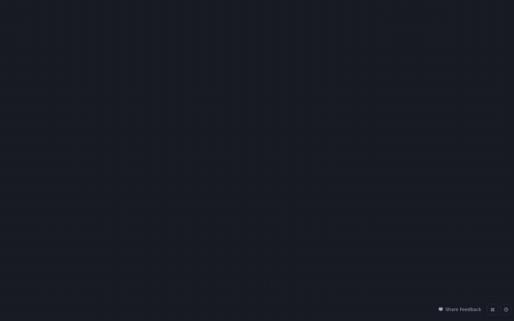

# BRANDBIRD-UI — snapshot tour of the reference work

Every capture below was taken from the locally served mirror
(`http://localhost:8899`, Playwright, 1600×1000). Captures are honest:
only what renders offline is shown as rendered; the rest is linked to
the mined inventory in [`data_ui.md`](./data_ui.md).

## Captures

### 1. Studio — empty dotted canvas

`snapshots/01-collection-studio.png` · DOM: `snapshots/01-collection-studio.html`

- Route `/collection.html`, HTTP 200, title *"ReferenceTool - Powerful
  image, mockup & screenshot editor for entrepreneurs"*.
- What renders: a **full-viewport dark dotted-grid canvas** (the
  design surface) and, bottom-right, the **"Share Feedback"** pill
  plus two small icon buttons (shortcuts / help). Nothing else boots
  without the backend — no panel stack, no template rail.
- Takeaway for OmniFrame: the canvas is the product. Chrome stays
  minimal; help lives in one corner affordance, not scattered prose.

### 2. Studio — fresh-collection variant

`snapshots/02-collection-fresh.png` · DOM: `snapshots/02-collection-fresh.html`

- `/collection.html?new=1` renders identically offline (same shell) —
  confirming all state comes from the API layer, not the static shell.

### 3. Index route (absent from mirror)
`snapshots/03-index.png` — `/index.html` is **not in the ZIP** (404
from the static server). Recorded so nobody re-chases it.

### 4. Mirror root (directory listing)
`snapshots/04-home.png` — the mirror contains only `collection.html`,
`_next/`, `_ext/`, `ingest/`. The studio is a single-page app.

### 5. Interactive enumeration
`capture-report.json` (in `snapshots/`) — the capture rig enumerated
visible buttons/inputs after boot: **zero buttons, zero inputs** in
the offline DOM beyond the feedback widget. The entire control
surface is client-rendered post-auth — which is why the inventory in
`data_ui.md` is bundle-mined, and labelled as such.

## What the panels look like (from the bundle, not screenshots)

The right-hand control stack is a titled accordion, literally
`"Mockup Controls"` (`w:"100%", innerSpacing:4, spacing:6`), whose
sections are the registry in `data_ui.md` §1: Mockup, Border, Shadow,
Background, Layout, Position, 3D Effect, Watermark, Annotation,
Title/Header, Images, Templates, Brands, AI. Each control row is the
same atom: `icon(14px) + label + slider(min/max/step) + value`
(e.g. *Border Radius 0–100*). Backgrounds are Flat / Gradient / Mesh
Gradient / Pattern / image; frames are MacBook / iPad / iPhone /
Browser / Android. Export & Share = Copy image, Download PNG/JPG.

→ Full verbatim inventory: [`data_ui.md`](./data_ui.md)
