# BRANDBIRD-UI — the real BrandBird studio, state by state

All captures: locally served mirror (SPA fallback), Playwright,
1600×1000. The uploaded test image in later shots is OmniFrame's own
Pack Browser screenshot — used only as a neutral picture to unlock
BrandBird's image-selected states.

## Shell & onboarding

### 01 · Welcome modal
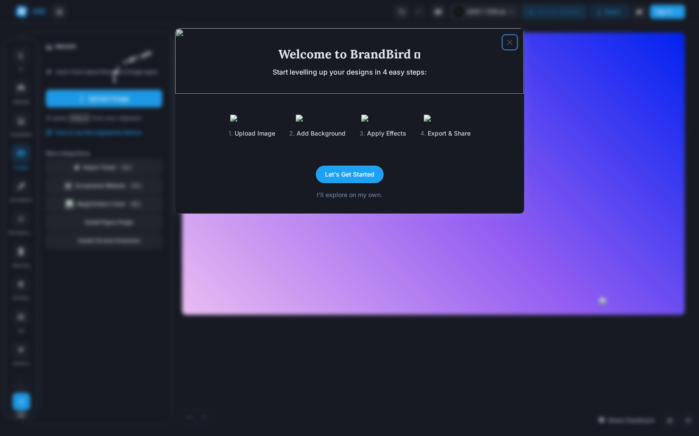
First run opens a centered modal over a blurred studio: "Welcome to
BrandBird — Start levelling up your designs in 4 easy steps:
1. Upload Image 2. Add Background 3. Apply Effects 4. Export & Share",
one primary **Let's Get Started**, and a quiet "I'll explore on my
own." escape. The whole product is explained in 4 verbs, once, then
never again — panels stay prose-free afterwards.

### 02 · Studio, default state (Images panel)
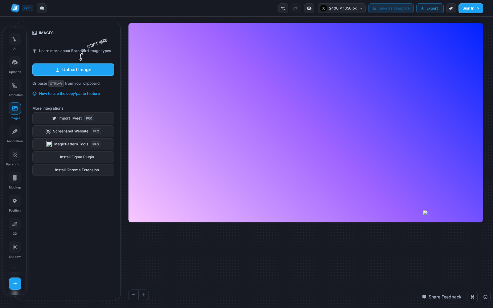
Top bar: logo + FREE badge · undo/redo · preview (eye) · canvas size
`2400 × 1350 px` · Save as Template · Export · Sign In.
Left: icon rail (icon over 10px label; active = filled blue tile +
blue label) beside a **floating rounded panel card**. Canvas: the
design on a dotted workspace, zoom −/+ bottom-left, Share Feedback
bottom-right. Default panel = Images: Upload Image (primary),
"Or paste CTRL+V", integrations (Import Tweet PRO, Screenshot
Website PRO, MagicPattern Tools PRO, Install Figma Plugin, Install
Chrome Extension).

## Rail sections (panel title · what it holds)

### 03 · AI — 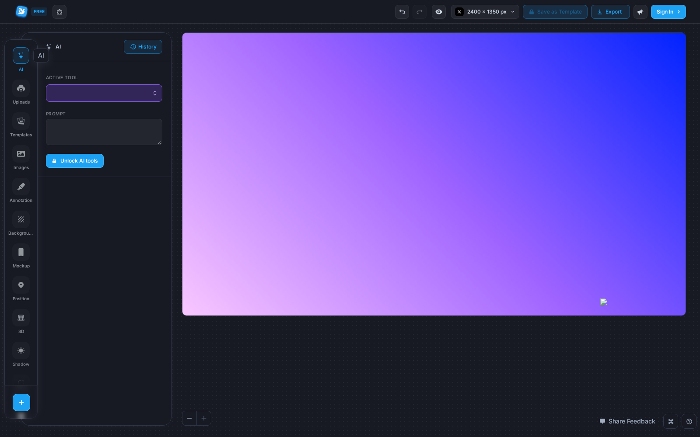
History / ACTIVE TOOL / PROMPT with an "Unlock AI tools" gate.

### 04 · Uploads — 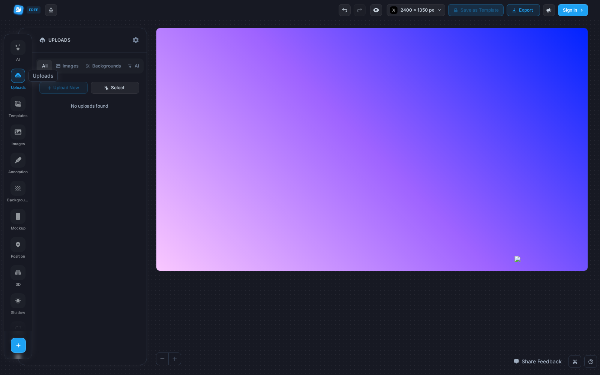
Filter chips: All / Images / Backgrounds / AI · Upload New · Select.

### 05 · Templates — 
Public / Saved tabs, "Or filter by platform:", template cards
(Airbnb iPhone screen, Spotify Wrapped, desktop+mobile mockups…).

### 06 · Images — same as 02 (Upload + integrations).

### 07 · Annotation — 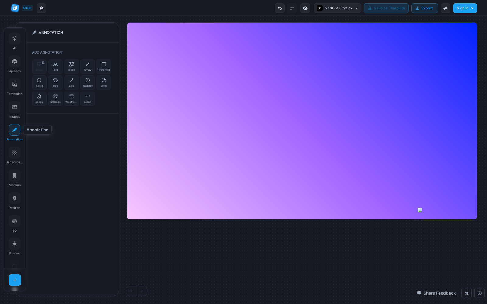
ADD ANNOTATION: Image / Text / Icons / Arrow / Rectangle (+ more).

### 08 · Background — 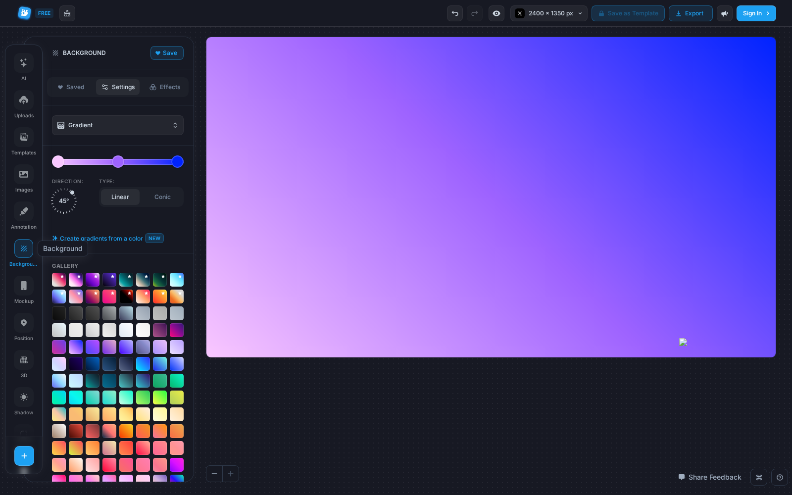
Save / Saved / Settings / Effects tabs; Gradient with DIRECTION 45°,
TYPE Linear/Conic segmented, "Create gradients from a color",
gallery. This is the purple-blue gradient on the canvas.

### 09 · Mockup (no image) — 
PRO badge. Empty state in caps: "PLEASE, SELECT AN IMAGE TO
CUSTOMIZE ITS MOCKUP." — the panel tells you what to do by naming
the missing selection, in one line.

### 10 · Position — 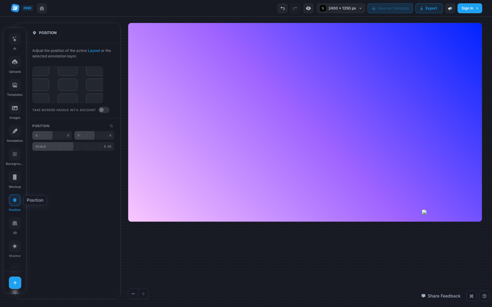
3×3 dashed position grid, TAKE BORDER RADIUS INTO ACCOUNT toggle,
POSITION X/Y numeric inputs, SCALE slider (label left, value right).

### 11 · Shadow (no image) — same empty-state pattern as 09.

### 12 · Border (no image) — same empty-state pattern as 09.

### 13 · Layout — 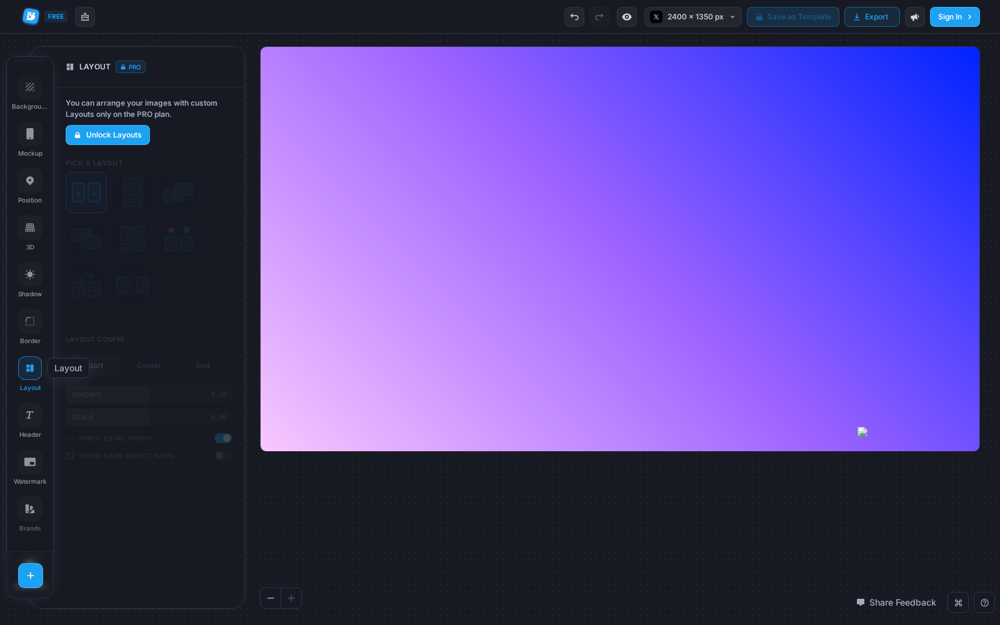
PRO gate inline: "You can arrange your images with custom Layouts
only on the PRO plan. Unlock Layouts" + PICK A LAYOUT, LAYOUT CONFIG
(Start/Center/End), SPACING 0.50, SCALE 0.80, FORCE EQUAL WIDTH.

### 14 · Watermark — 
PRO · styles: Classic / Fullscreen / Dark / Light.

### 15 · Brands — 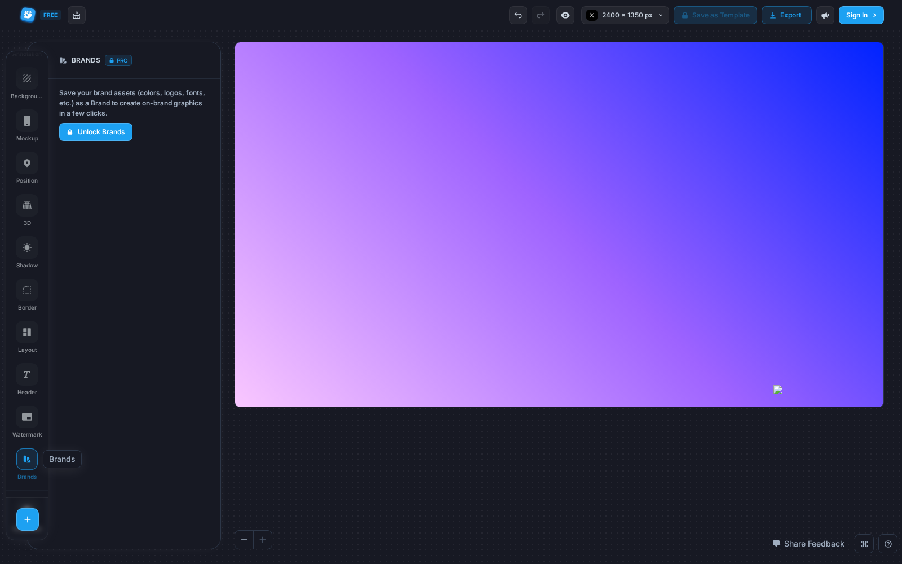
PRO · "Save your brand assets (colors, logos, fonts, etc.) as a
Brand to create on-brand graphics in a few clicks."

### 17 · 3D Effect — 
Empty state: "PLEASE, SELECT AN IMAGE TO USE THE 3D EFFECT."

### 18 · Header — 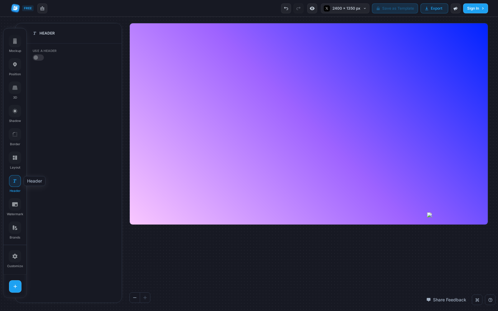
USE A HEADER toggle — title/header text layer for the graphic.

## With an image (states the empty panels were asking for)

### 19–20 · Image added / selected
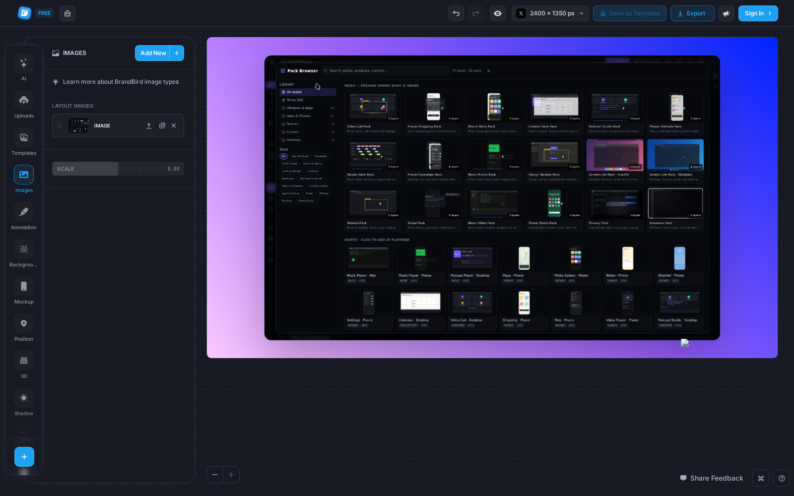 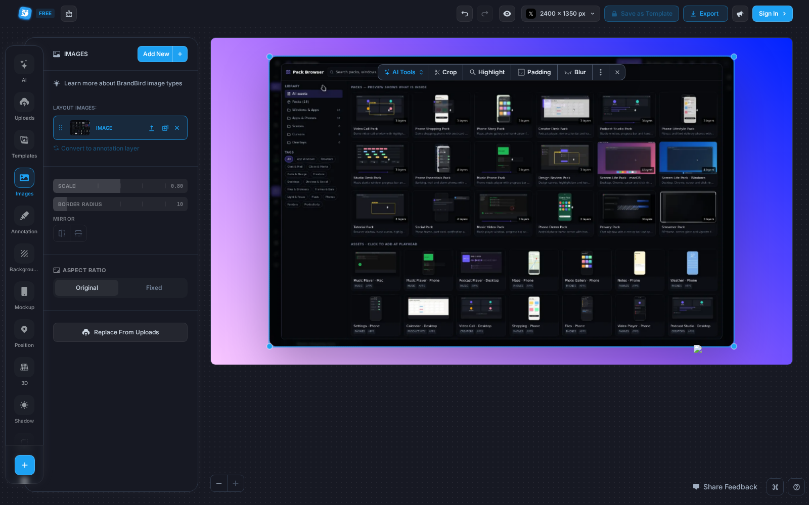
Upload places the image centered on the gradient; selecting it
draws blue handles and floats the **selection toolbar** above it:
**AI Tools ✦ · Crop · Highlight · Padding · Blur · ⋮ · ✕**.

### 21 · Mockup controls — 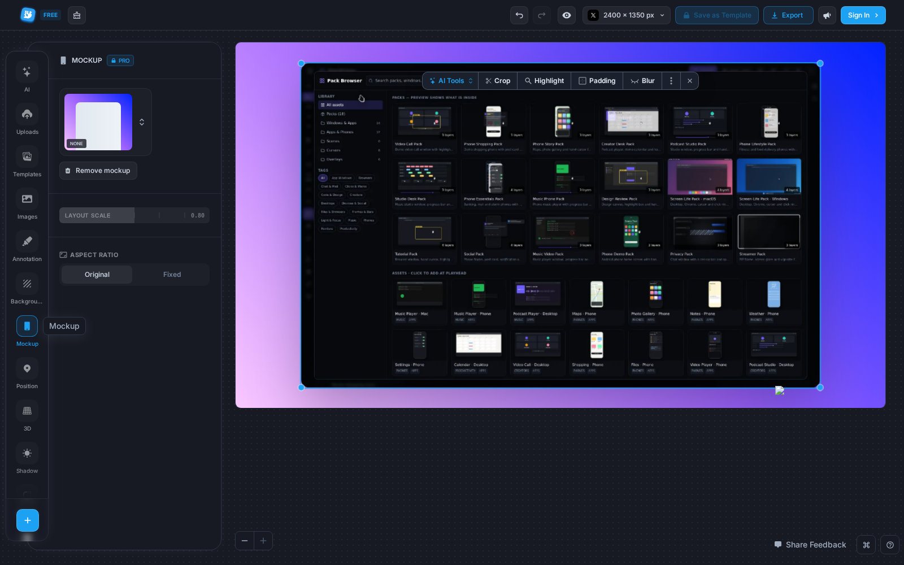
Frame preview tile (NONE) with switcher, Remove mockup,
LAYOUT SCALE slider 0.80, ASPECT RATIO segmented Original/Fixed.

### 22 · Shadow controls — 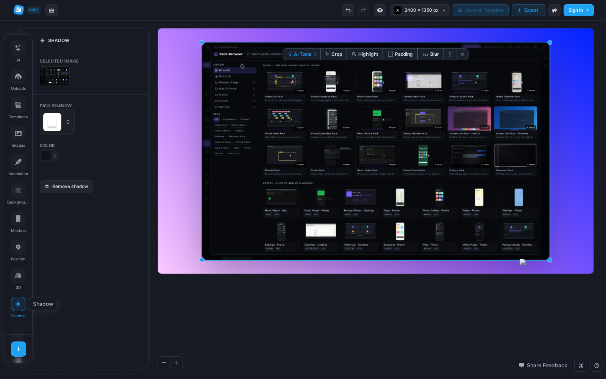
SELECTED IMAGE · PICK SHADOW · COLOR · Remove shadow.

### 23 · Border controls — Border-radius/width control rows (2 sliders).

### 24 · Position controls — X/Y inputs + SCALE (3 sliders).

### 25 · Export options — 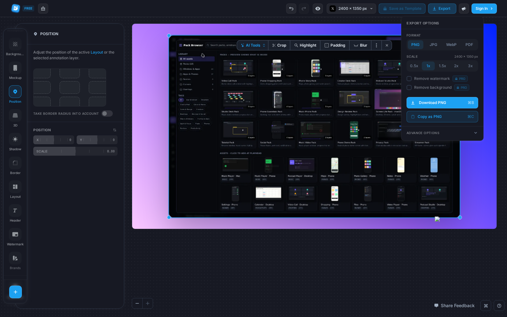
EXPORT OPTIONS popover: FORMAT chips PNG/JPG/WebP/PDF · SCALE chips
0.5x/1x/1.5x/2x/3x with resulting `2400 × 1350 px` · Remove watermark
PRO · Remove background PRO · primary **Download PNG ⌘B** · **Copy as
PNG ⌘C** · ADVANCE OPTIONS expander.

## Lessons applied to OmniFrame

- Floating contextual toolbar over the selection → **shipped**:
  OmniFrame monitor selection quick-bar (Effects/Text/Split/Delete).
- One onboarding moment, then zero panel prose — matches our Help
  docker direction; their per-panel text is labels + one-line empty
  states only.
- Export = one popover, format/scale as chips, primary action carries
  its shortcut — reference for our export surface (`data_ui.md` §6).
- PRO gating is inline and honest (badge + one-line gate), never a
  blocking wall before you can see the tool.
